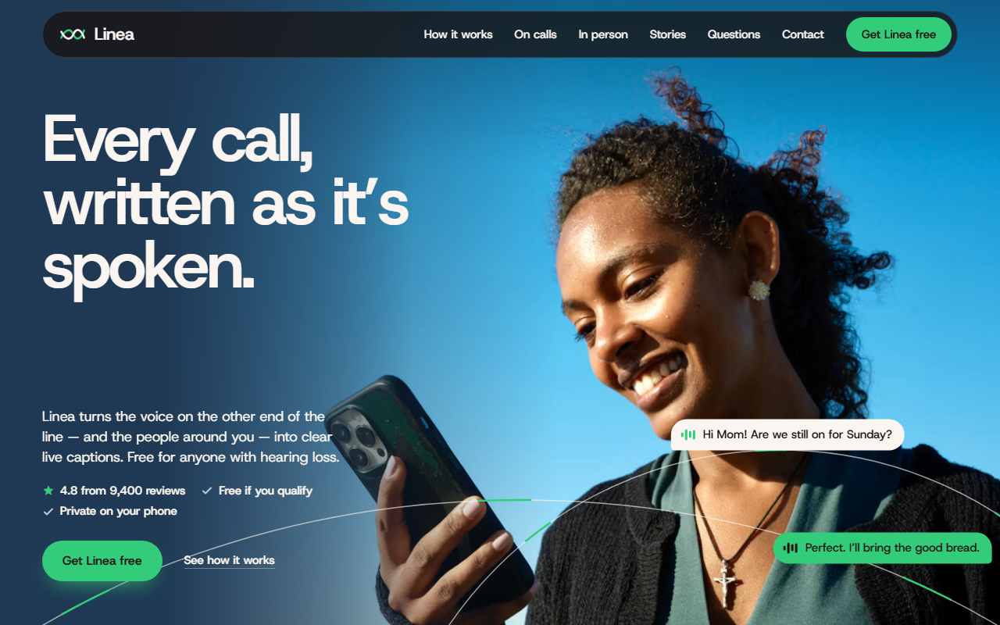
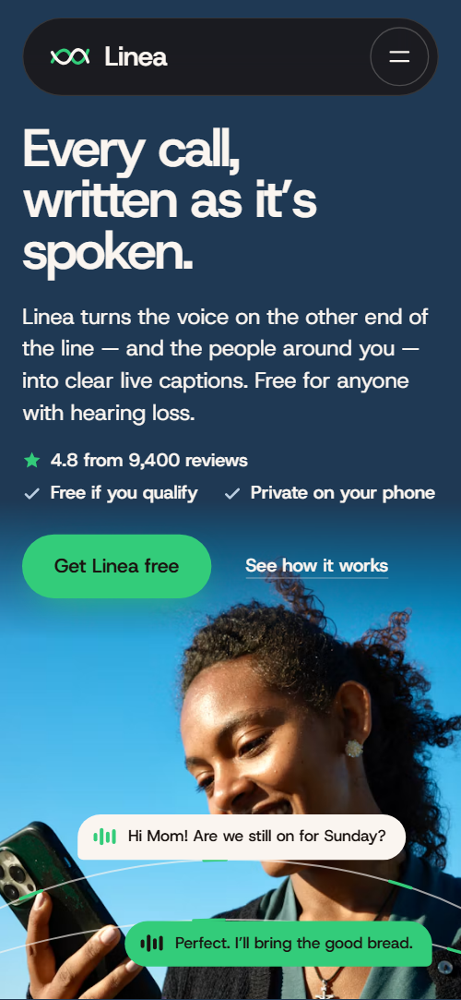
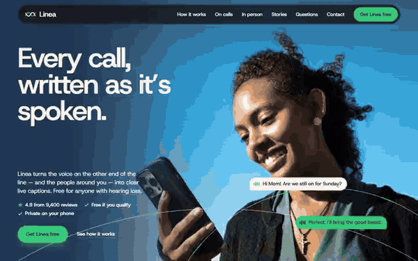

# Free HTML app landing page template with GSAP scroll animations

App landing page template: a free HTML page for a mobile app or SaaS product that offers a free plan or a sign-up. A phone drawn in HTML fills with a call as you scroll, and ten sections run from the headline to a contact form. Warm paper, navy and espresso bands carry one green accent. Hand the file and AGENTS.md to Claude Code, Cursor or Codex to turn the demo into your product's page.

[](LICENSE)  

**[Live demo](https://8bsite.github.io/app-landing-page-template/)** · **[Use this template](https://github.com/new?template_name=app-landing-page-template&template_owner=8bsite)** · **[Download ZIP](https://github.com/8bsite/app-landing-page-template/archive/refs/heads/main.zip)** · **[Template page on 8b.com](https://8b.com/templates/linea/)**

<a href="https://8bsite.github.io/app-landing-page-template/"></a> <a href="https://8bsite.github.io/app-landing-page-template/"></a>

<p align="center"><a href="https://8bsite.github.io/app-landing-page-template/"></a><br><sub>Scroll animation</sub></p>

## Use it with Claude Code, Cursor or Codex

Download the four files into your project folder (`curl.exe` in Windows PowerShell):

```bash
curl -LO https://raw.githubusercontent.com/8bsite/app-landing-page-template/main/index.html
curl -LO https://raw.githubusercontent.com/8bsite/app-landing-page-template/main/AGENTS.md
curl -LO https://raw.githubusercontent.com/8bsite/app-landing-page-template/main/LICENSE
curl -LO https://raw.githubusercontent.com/8bsite/app-landing-page-template/main/CREDITS.md
```

Then fill in the angle brackets and give your agent this prompt:

```text
Read AGENTS.md, then edit index.html. Rework it into a landing page for <my app or SaaS product: what it does, who it is for, plan or prices, where people sign up or download, the features, my real rating and reviews, support hours and contacts>. Replace first the brand name, the headline, the features, the phone's call screen, the reviews and the clinician quote. Keep the section ids, the classes AGENTS.md lists, the phone step numbers, hero directly before listen and calls directly before tune; update each length number to its line's character count. If a fact is missing, ask me; never invent ratings, reviews, prices, store links or contacts.
```

Vibe coding this page with Claude Code, Cursor or Codex goes in a clear order. First the brand name, the headline and the five demo features change; then the phone's call is rewritten to show your own product. Keep the section ids, the data-step numbers that tie each feature to a phone element and the data-ctl controls. Three --len attributes size the two sample lines and the footer wordmark; set each to its line's character count. The rating, the eight reviews, the clinician quote and the free-plan and privacy claims are invented, so the agent has to ask for real ones and may not make up a number, a review or an endorsement.

No agent? Click **[Use this template](https://github.com/new?template_name=app-landing-page-template&template_owner=8bsite)**, edit `index.html` on GitHub and turn on **Settings > Pages**.

## Sections and motion

- **Navigation**: top bar: logo, section links, Get Linea free button; phone menu overlay.
- **First screen**: first screen: headline over a full-bleed photo, lead, proof line, button; caption chips ride curved lines across the photo. Smooth scrolling runs page-wide and several section headings slide up line by line. Leaving the hero, the photo zooms while copy and caption chips lift at different speeds.
- **Nothing lost between a voice and a word.**: two-panel stage: speech on one side, readable captions on the other (demo: They speak / You read). Pinned, three spoken lines drawn as bars slide into the You read panel and become caption bubbles while the waveform ripples.
- **Calls that feel easy again.**: feature list beside a sticky phone whose screen builds one step per feature. Each feature brightens as it reaches mid-screen and the sticky phone adds that step's messages; on exit the phone shrinks and tilts.
- **Captions, set your way.**: a wall-sized sample sentence over a list of eight settings with drawn controls. The sample card grows out of the phone screen; then, tied to scroll, its sentence thickens and the card flips from light to dark.
- **Captions for the room, too.**: horizontal track of five places with photos and caption pairs, two curved lines run through all of them. Pinned, five places slide sideways as you scroll, two curved lines draw along, and each card's caption pair rises in.
- **Recommended by clinicians. Loved by the people who use it.**: expert quote with portrait beside two columns of short reviews. Review columns rise at two different speeds, or cards slide in from alternate sides on phones, while the portrait zooms out.
- **Three steps, then just talk.**: three numbered step cards that stack on top of each other. The three step cards stick and stack as you scroll; each new card shrinks and dims the one beneath.
- **Questions, answered plainly.**: questions and answers (native &lt;details&gt;).
- **Your next call can be the easy one.**: closing call to action over a photo that opens from a small window to the full band. The photo opens from a small window to the full band, and green bars over the heading clear word by word.
- **Talk to a person, any way you like.**: support hours, a photo, three ways to reach the team and a contact form (placeholders).
- **Footer**: tagline, link columns, giant wordmark, copyright with the Design: 8B credit and a legal note. Tied to scroll, the giant wordmark rises into place while the logo's two strokes draw themselves.

## Design

 espresso text and dark bands  
 warm paper background  
 deeper paper bands and review cards  
 green buttons, your captions, curved lines  
 muted body text  
 navy hero and calls band  
 pale blue text on navy  
 dark brown fill behind the place photos, the closing photo and the Room mode pill  
 muted text on espresso

**Host Grotesk**: the only family: large, tightly tracked semibold headings and regular body text (Google Fonts). Each section after the hero is a sheet with large rounded upper corners laid over the last, in paper, navy and espresso. Captions are chat bubbles with a tiny waveform: paper for the other voice, green for yours. The phone is built in HTML, not a screenshot, and the main call-to-action buttons are green pills while the form's send button is espresso.

## Questions

**Does this website app template include the app itself?**  
No. It is only the website for an app: one MIT licensed HTML file that you host anywhere. The phone on the page is drawn in HTML and CSS, so it shows a captioned call but runs nothing. Your real app lives in an app store or behind your own sign-up page, and you point the buttons there.

**Can I use it as a SaaS landing page template?**  
Yes. For a SaaS website template the question is whether your features can be shown one at a time on a screen. If so, replace the captioning demo with your own: the call on the phone, the eight settings rows and the five in-person places. AGENTS.md has the steps for removing a section you do not need.

**Where do the Get the app buttons lead?**  
Only within the page. The nav, menu, hero, calls and footer calls to action jump to the closing call to action, and the button inside it scrolls back up to the hero. There are no store badges or sign-up links yet, so point each one at your store or sign-up URL.

## Is it the right base?

Reach for this one when a visitor should understand an app by watching it work, and the next step is a download or a free sign-up. Many mobile app landing pages work that way, and here a single phone accompanies the feature list and shows each item. If the product is a gadget with a ship date and a pre-order button, start from the [product launch](https://8b.com/templates/hushkey/) template instead. The catch is the demo story: the speech stage, the Room mode places and the clinician quote belong to a captioning app, so a product with no voice or conversation in it must rework those sections or delete them.

## Before you publish

- Replace what is marked `data-8b-placeholder` (social preview image, favicon, phone, email, form) and the invented demo facts; [AGENTS.md](AGENTS.md) lists them.
- The form sends nothing yet: connect it to Formspree or Netlify Forms, or remove it.

## Tech

GSAP 3.13.0, ScrollTrigger, SplitText, Lenis 1.3.27 from jsDelivr, 134 KB, no build step. Chrome and Edge 111+, Safari 16.2+, Firefox 113+ (it uses color-mix(), container query units, cascade layers, small/dynamic viewport units). With "reduce motion" on, the page is complete and still.

## License

MIT, see [LICENSE](LICENSE). Photos, fonts and libraries keep their own licences: [CREDITS.md](CREDITS.md). More free templates: [8b.com/templates](https://8b.com/templates/) · [github.com/8bsite](https://github.com/8bsite).
